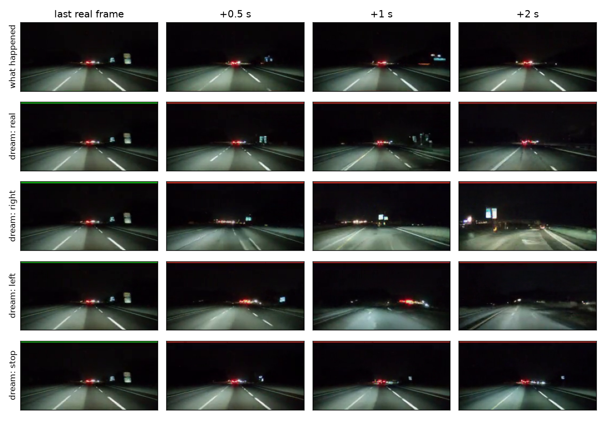
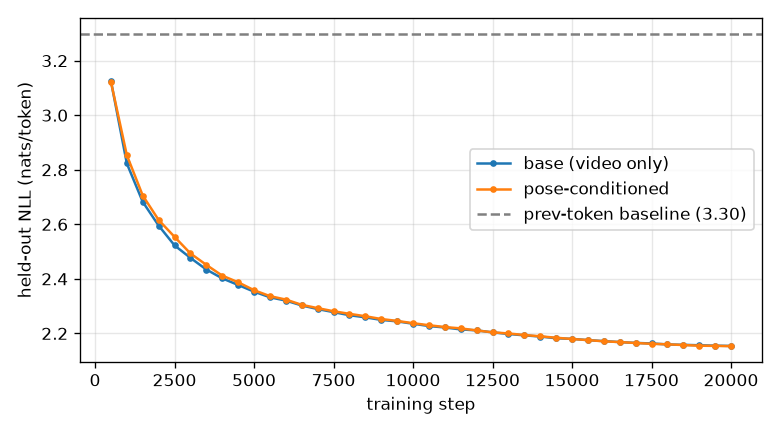

# commavq-world-model

A small GPT world model for driving video, trained from scratch on one laptop GPU. It predicts the next dashcam frame from the last 15, can "dream" 2 seconds of future driving, and, once it's fed the car's motion, follows steering commands it's given: turn right, turn left, stop.

All numbers below come from held-out data, and the tests for each milestone were written down before the results came in. Two of them failed, and both failures are reported as they came out.



*One held-out night clip. Top row: what really happened. Below it: the model's dream from the same 15 real frames with the real motion, a right turn, a left turn and a stop fed in. In the stop row the lane dashes stay put; in the turn rows the road swings away.*

## Setup

- **Data:** [commaVQ](https://huggingface.co/datasets/commaai/commavq) (MIT). Dashcam video at 20 fps, already compressed by comma's VQ encoder: each frame is 8x16 = 128 tokens from a 1024-word codebook. Train = shards 0-2 (7,500 one-minute segments, 125 h). Test = shard 39, held out completely.
- **Model:** decoder-only transformer, 8 layers, d=512, 26.3 M params, 16-frame context (2,048 tokens). Trained 20k steps on an RTX 5050 (8 GB): ~5.5 h, peak 3.1 GB VRAM.
- **Metric:** cross-entropy of frame t given the frames before it, in nats/token, on 400 test segments.
- **Disk:** ~10.5 GB in total (venv 6.8, tokens 3.2, decoder 0.17).

## M1: does it beat copying?

At 20 fps neighbouring frames look almost the same, and 40% of tokens are identical to the token at the same spot one frame earlier. So the bar is a "prev-token" baseline that predicts each token from the one at the same position in the last frame.

| Model | held-out nats/token |
|---|---|
| uniform | 6.93 |
| unigram | 6.85 |
| prev-token baseline | 3.30 |
| **base model** | **2.154** |



It passes the baseline within the first 600 steps and is still edging down at 20k (-0.003 over the last 1,500 steps). Train and test loss track each other, so there's no overfitting. More steps won't buy much now; more data or a bigger model might.

## M2: is it just a smart copy machine?

Same target frame, scored with 1 to 15 frames of context (2,048 fixed test windows), with the loss split into tokens that repeat from the last frame and tokens that change:

| Context | all | repeat (40%) | changed (60%) |
|---|---|---|---|
| prev-token baseline | 3.286 | 0.897 | 4.881 |
| 1 frame | 2.600 | 0.668 | 3.889 |
| 2 frames | 2.334 | 0.643 | 3.463 |
| 4 frames | 2.188 | 0.624 | 3.231 |
| 8 frames | 2.117 | 0.613 | 3.121 |
| 15 frames | 2.096 | 0.607 | 3.091 |

Going from 1 to 15 frames gains 0.50 nats (paired 95% CI 0.498-0.510), and 95% of the gain is on the tokens that change. The biggest jump is from 1 to 2 frames, since it takes two frames to see speed. After that the gains shrink, and memory stops paying after about 8 frames (0.4 s). **It uses the past to predict motion; it's not just copying.**

## M3: dreams

The model samples 40 frames (2 s) after 15 real ones, on 16 held-out clips picked by a fixed seed before generating, with 2 samples each. Videos are in `runs/base/dreams/`, including the worst clip.

- **They look right.** Roads, lane lines, cars, signs and night scenes stay coherent for the full 2 s. The motion rate (share of tokens that change per frame) is 0.60-0.62 in dreams vs 0.58-0.62 in real video, so they neither freeze nor melt into noise.
- **Test failed: they don't beat a frozen last frame on pixel error.** Pixel MAE against the real future ties the frozen-frame baseline (13.3 vs 13.3 at 0.5 s, 21.6 vs 20.2 at 2 s), and only 6/16 clips win. In the worst clip the real car brakes for a stop sign while the dream keeps cruising. It's a believable future, just not the one that happened, and pixel error punishes that. The dream has no way to know what the driver chose to do, which is what M4 is for.

## M4: give it the car's motion, then lie about it

commaVQ ships a 6-number pose per frame that isn't documented, so I worked out what it means from the data: `[vx, vy, vz]` in m/s and `[roll, pitch, yaw]` rates in rad/s, openpilot car frame. Yaw > 0 means a right turn, which I checked by matching yaw sign to image shift on 40 strong turns. The pose run adds `Linear(6 -> 512)` of the previous step's motion to every token of each frame. It's zero-initialised, so at step 0 it's exactly the base model (identical test NLL, 7.0473). It was trained the same 20k steps and ended at 2.153 (base 2.154).

Four tests, written before any results:

| Test | Result | Numbers |
|---|---|---|
| 1. It uses the pose: shuffled pose scores worse than real | **pass** | real 2.090, shuffled 2.227; gap 0.136 nats (95% CI 0.130-0.143) |
| 2. With the real pose, dreams beat the frozen frame at short horizons | **fail** | 7.7 vs 7.4 at 0.05 s, 13.1 vs 13.3 at 0.5 s; 6/16 clips win, same as M3 |
| 3. Steer right turns right, steer left turns left (yaw +-0.2 rad/s) | **pass** | image shift: right +16.7 px, real -3.2, left -30.1; right is right of left on 16/16 clips |
| 4. Stop slows the dream | **pass** | motion rate 0.44 vs 0.60 with the real pose; lower on 16/16 clips |

**What this says:** the model really is action-conditioned. Change the controls and the imagined world responds the right way, on every clip. But knowing the real motion barely helps it predict the real pixels: the real pose beats no pose by only 0.006 nats (CI 0.004-0.008), because 15 frames of video already show how the car is moving. Wrong motion costs a lot (+0.136), right motion adds almost nothing. Test 2 fails because the randomness in sampling, not the car's motion, dominates pixel error over 2 s.

Two things I can't fully explain:
- Left turns shift the image about twice as far as right turns on average. Part of that is one clip at -122 px; on medians it's -19 vs +12.
- "Stop" lowers motion to 0.44, not 0. Other cars keep moving and the VQ codes flicker, but I haven't separated those two.

**Caveat:** comma estimated the poses from the video itself, so the pose carries a little information about the frame being predicted. That would make test 1 easier to pass, but it doesn't touch tests 3 and 4, where the pose is made up.

## Run it

```bash
make download prepare selftest baselines   # 4 shards, sha256-checked; selftest 19/19
make start RUN=base                         # ~5.5 h, background; make status / stop / resume
make ablate RUN=base                        # M2
make dreams RUN=base                        # M3, ~20 min
make start RUN=pose ARGS=--pose             # M4 model
make poseeval                               # test 1
make steer                                  # tests 2-4, ~2 h (decoding runs on the CPU)
make figures                                # runs/curve.png, runs/pose/steer.png
```

Python calls use `-E -s` so a ROS install on `PYTHONPATH` can't break imports.

## Files

| File | What |
|---|---|
| `prepare.py`, `src/data.py` | shards to uint16 token arrays + pose; train/test windows |
| `src/model.py`, `train.py` | GPT, optional pose embedding, resumable training |
| `baselines.py` | uniform / unigram / copy / prev-token baselines |
| `ablate.py` | M2 context ablation with paired bootstrap CIs |
| `dreams.py`, `render.py` | rollouts, decoding to pixels, pixel MAE / motion / turn metrics, videos |
| `poseeval.py` | M4 test 1 (base vs real vs shuffled pose) |
| `curve.py`, `steer_figure.py` | figures |
| `selftest.py` | 19 checks (data, masking, zero-init pose = base model, resume) |
| `EXPERIMENTS.md` | data, baselines and pre-registered tests |
